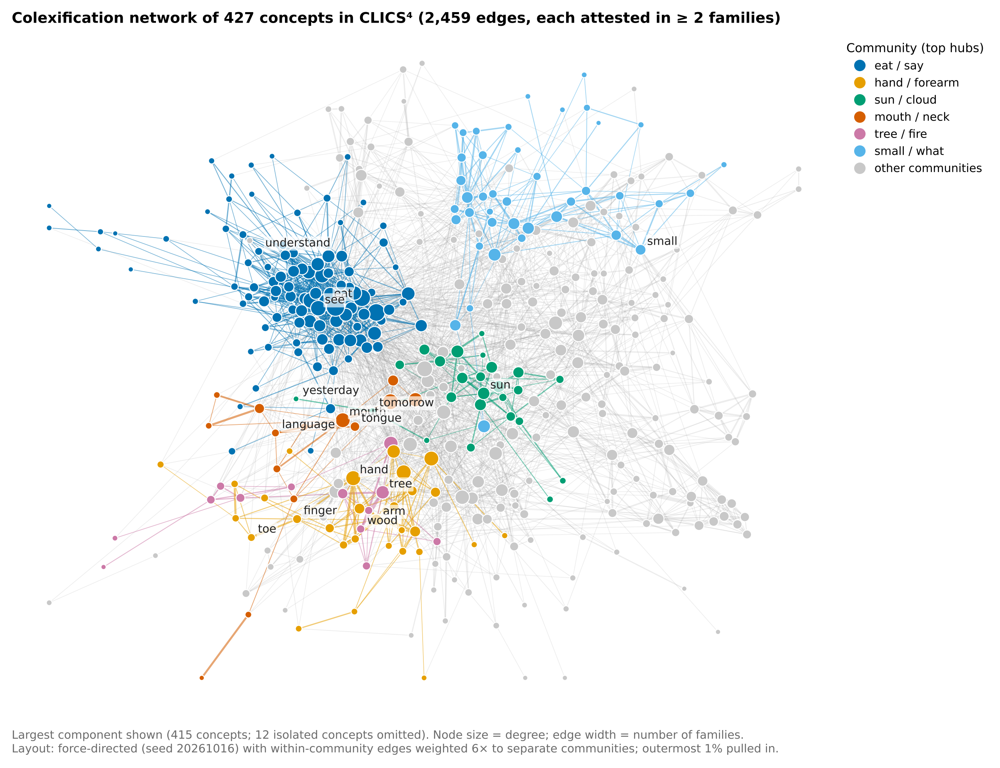
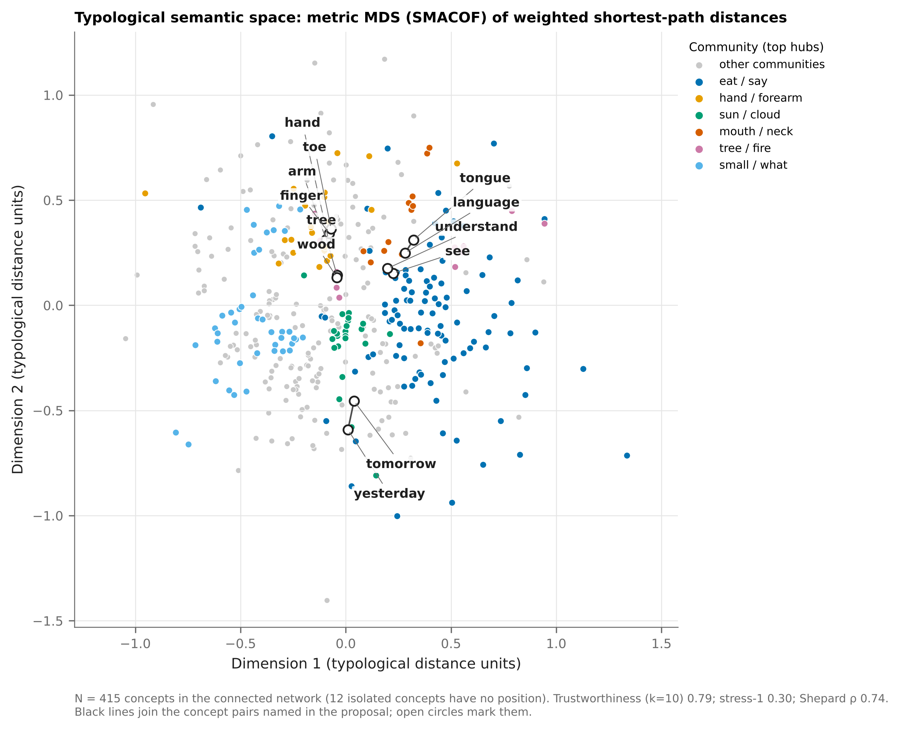
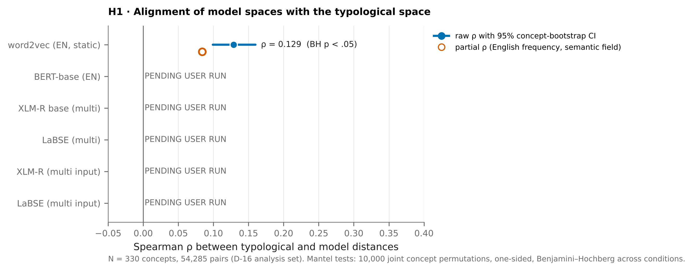
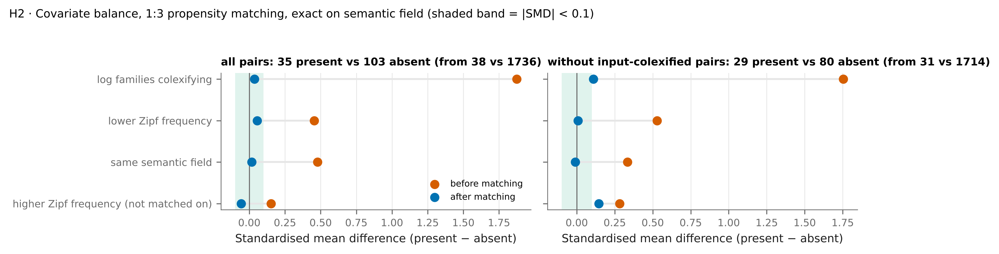
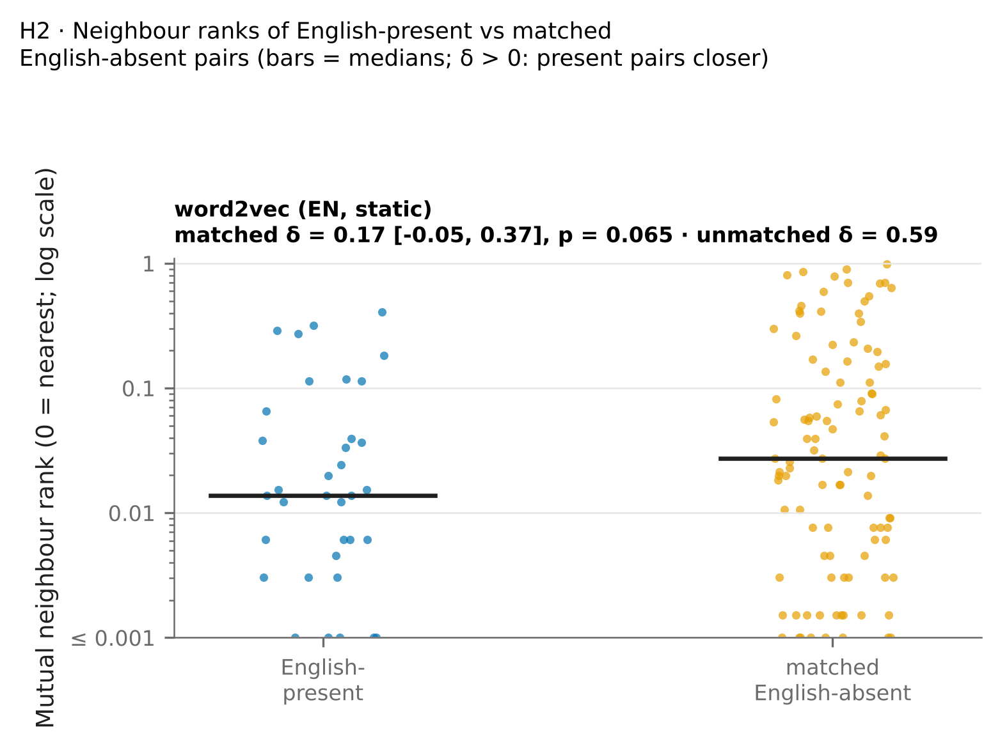
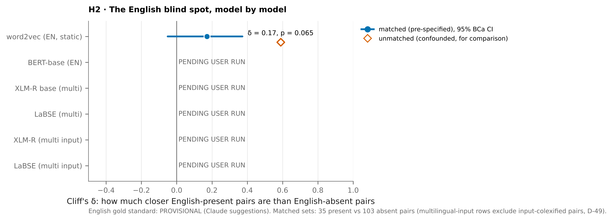
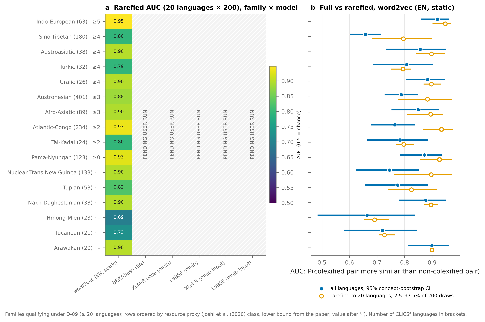
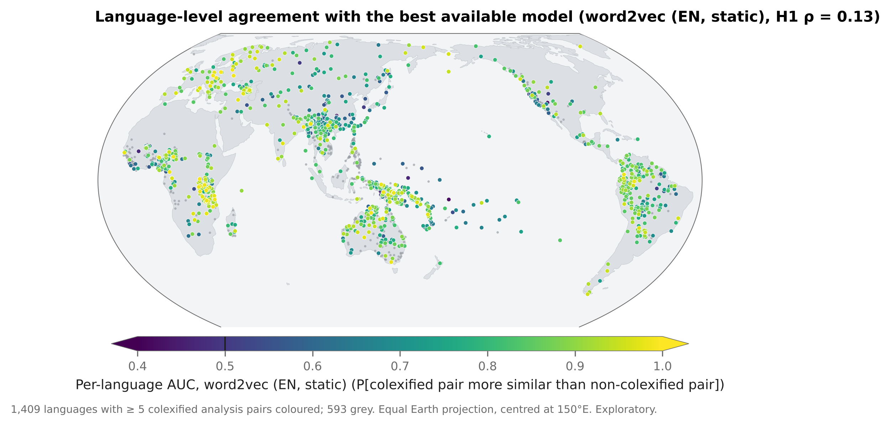
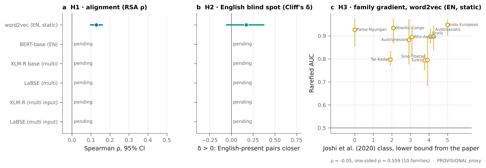

# Do language models think in English? Colexification as a test of cross-linguistic semantic structure

**Generated** {{generated_on}} from `results/` at commit `{{git_commit}}` by `python -m src.report.build_report`.
Every number below is substituted from a file in `results/`; the mapping from each number to its source file is
`results/report_values.json`. Conditions computed: **{{n_conditions_done}} of {{n_conditions}}**
({{conditions_done}}). Pending: {{conditions_pending}}.

---

## Abstract

Languages differ in which meanings they give a single word. Hindi–Urdu *kal* means both 'yesterday' and 'tomorrow';
Russian *рука* covers both 'hand' and 'arm'; English keeps all four apart. When many unrelated languages colexify two
meanings — express them with one word — that is evidence the two meanings are conceptually close for human beings
[@francois2008semantic; @youn2016universal]. This study asks whether the semantic spaces of language models reproduce
that cross-linguistic structure, or mainly reproduce English. We build a family-weighted colexification network from
CLICS⁴ ({{n_varieties_included}} language varieties, {{n_languages}} languages, {{n_families}} families) over
{{n_working}} concepts, and compare its geometry with up to six model conditions, from static English word2vec through
BERT, XLM-R and LaBSE to multilingual transformers fed non-English word forms. Three pre-registered hypotheses are
tested: that model similarity tracks colexification (H1), that models capture colexifications English happens to have
better than matched ones it lacks (H2, the *English blind spot*), and that the fit is uneven across language families
(H3). For {{best_label}}, the alignment is positive but modest (ρ = {{h1_rho}}, 95% CI {{h1_ci}},
{{h1_p}}), and about {{h1_drop_share}} of it is explained by English word frequency and semantic field together.
{{abstract_h2}}: unmatched, English-present colexifications look far closer
(δ = {{h2_delta_unmatched}}) than English-absent ones, but after matching on cross-linguistic breadth, frequency and
semantic field the difference falls to δ = {{h2_delta}} {{h2_ci}}, {{h2_p}}. {{abstract_h3}} the model separates colexified from non-colexified pairs above chance
(AUC {{h3_auc_min}}–{{h3_auc_max}}), with Indo-European highest. We report {{n_checks}} robustness checks, of which
{{n_survive}} reproduce the primary conclusion. The remaining {{n_conditions_pending}} model conditions, the human audit of the
English gold standard and the Wikipedia resource proxy are marked PENDING USER RUN and are not estimated anywhere in this
report.

**Keywords:** colexification, lexical typology, distributional semantics, multilingual language models, CLICS,
representational similarity analysis.

---

## 1. Introduction

A Hindi or Urdu speaker who says *kal* may mean yesterday or tomorrow; which one is fixed by the verb, not by the noun.
To an English speaker the merger looks like an accident of vocabulary, even a defect. It is neither. The same pattern
recurs across South Asia and beyond, and it has a transparent conceptual motivation: both days are *the day adjacent to
today*, one step away from the present in time. English does not lexicalise that concept, so an English speaker has no
single word for it — but the concept is available, and many languages name it.

Patterns of this kind are the subject matter of lexical typology. When one word in one language covers two concepts, the
two are said to be **colexified** [@francois2008semantic]. Aggregated over many unrelated languages, colexification is a
measure of conceptual proximity: pairs colexified in many independent families (ARM~HAND, TREE~WOOD, SKIN~BARK) are
pairs that human communities repeatedly judge to be close enough to share a name [@youn2016universal;
@jackson2019emotion]. The Database of Cross-Linguistic Colexifications [CLICS; @rzymski2020clics; @tjuka2025clics4paper]
turns this into a network over concepts, built from standardised wordlists in thousands of varieties.

Language models also carry a semantic space. Distributional models place words in a vector space whose geometry
reflects co-occurrence in text; multilingual models are trained on text in a hundred languages and are routinely
described as having a *shared* or *language-agnostic* semantic space [@conneau2020xlmr; @feng2022labse]. If that
description is right in a strong sense, a multilingual model's geometry should look like the world's colexification
geometry rather than like English. If it is right only in a weak sense — the model aligns other languages onto an
English-shaped space — then the model's similarities should track English lexicalisation, and should be systematically
worse wherever English draws a distinction the rest of the world does not.

That is the question this study asks, in three parts, pre-registered in `DECISIONS.md` before any analysis was run:

* **H1 (alignment).** Concept pairs colexified in more language families are closer in model space.
* **H2 (the English blind spot).** Models capture colexifications that English itself has (SEE~UNDERSTAND) better than
  matched colexifications it lacks (ARM~HAND), with the gap shrinking for multilingual models and for multilingual input.
* **H3 (typological unevenness).** The fit between model space and a family's colexification pattern increases with that
  family's digital resources.

The contribution is less the direction of H1, which is unsurprising, than the discipline applied to H2 and H3.
English-present colexifications are not a random sample of colexifications: as this study documents, they are
dramatically more widespread cross-linguistically than English-absent ones, more often within one semantic field, and
built from more frequent words. An unmatched comparison therefore measures those confounds rather than an English bias.
The matched design, the audited English gold standard, and the explicit separation of confirmatory from exploratory
analyses are what make the answer interpretable.

## 2. Related work

**Colexification as conceptual structure.** Semantic maps [@haspelmath2003geometry] and colexification networks
[@francois2008semantic] formalise the observation that polysemy is not arbitrary. @youn2016universal show that the
structure of a 22-concept subdomain is near-universal across 81 languages; @jackson2019emotion extend the method to
emotion concepts and find both universal structure and cultural variation. @xu2020conceptual show that conceptual
relations such as causal and taxonomic links predict which pairs colexify; @brochhagen2022goldilocks argue that
colexification balances informativeness against effort, and @regier2015efficient make the same efficiency argument for
category systems in general. CLICS³ [@rzymski2020clics] and CLICS⁴ [@tjuka2025clics4paper; @tjuka2026clics4data] provide
the aggregated database this study uses.

**Model semantic spaces and their typological reach.** Static embeddings [@mikolov2013distributed] and contextual
encoders [@devlin2019bert] both yield similarity geometries that can be compared with human data.
@bommasani2020interpreting show how to reduce contextual encoders to static vectors by pooling over contexts, which is
the method used here. @ethayarajh2019contextual document how anisotropic those spaces are, motivating the mean-centring
applied in this study. For multilingual models, @vulic2020probing probe how much lexical-semantic knowledge survives
in XLM-R, and @joshi2020state quantify the resource inequality across the world's languages that H3 is about.
@thompson2020cultural (cited in the proposal) is the closest antecedent for the present design: they compare
distributional semantic alignment across languages and find that alignment decays with cultural distance. The step
taken here is to replace cross-language alignment with the typological colexification network itself, and to test the
English-specific blind spot directly.

**Representational similarity.** Comparing two similarity structures over the same items is representational
similarity analysis in cognitive neuroscience [RSA; @kriegeskorte2008rsa] and the Mantel test in ecology
[@mantel1967detection], with partial variants [@smouse1986partial] and dyadic regression extensions
[@dekker2007mrqap]; this study uses all three.

## 3. Data

### 3.1 Colexification

The colexification data are CLICS⁴ v1.0 [@tjuka2026clics4data], pinned to one commit. The release covers
{{n_varieties}} varieties; {{n_varieties_included}} remain after dropping Glottolog's *Bookkeeping* pseudo-family,
which reduce to {{n_languages}} distinct Glottolog languages in {{n_families}} families (of which {{n_isolates}} are
isolates, counted as one-language families as in CLICS). Genealogy, macroareas and coordinates are re-attached from
Glottolog 5.3 [@glottolog53]; the re-attachment disagrees with the family shipped in CLICS⁴ for
{{n_family_disagreements}} varieties.

Rather than reading CLICS⁴'s precomputed colexification table, we recompute colexifications from the form table, so
that per-family counts, coverage and example forms are available. Two concepts are colexified in a variety when they
share an identical IPA segment string. Validated against the shipped table over all concepts and varieties, the recount
reproduces it exactly: {{n_pairs_clics}} pairs, with variety, language and family counts equal for
{{validation_share}} of them (`results/clics_validation.json`).

One data-quality decision matters enough to state here. Some source datasets map a single lexicon entry to several
concepts; such an entry produces a colexification that is an artefact of the mapping rather than a fact about the
language. Counting those entries would, for instance, make HE~SHE one of the most widely colexified pairs in the world.
The primary analysis therefore uses only forms whose source entry maps to one concept, and the alternative is kept as a
robustness check (it yields {{n_edges_evidence_all}} edges instead of {{n_edges}}, with the pair-level rates correlating
at ρ = {{spearman_evidence}}).

### 3.2 Concepts

CLICS⁴ covers {{n_concepts_total}} Concepticon concept sets, most of them thinly attested. We retain concepts attested
in at least {{knee}} language families, the knee of the coverage curve located by the Kneedle algorithm
[@satopaa2011kneedle] (Fig. S1; `figures/figS1_concept_coverage.pdf`), which yields {{knee_n}} concepts — inside the
proposal's 300–500 target without further constraint. Two concepts named in the proposal fall just below the knee
(UNDERSTAND, LANGUAGE) and are re-admitted by a pre-specified anchor rule; {{n_excluded}} concepts are excluded and
{{n_overrides}} English glosses are overridden where the Concepticon gloss would collide with another concept's
(for example FLY (INSECT) and FLY (MOVE THROUGH AIR) would otherwise both be *fly* and receive identical vectors).
The working set is **{{n_working}} concepts** across {{n_fields}} semantic fields, frozen with its order and a
SHA-256 (`{{concept_order_sha}}…`) that every matrix in the project carries and is checked against on load. A second
set of {{n_robustness_set}} concepts at a stricter threshold is kept for robustness check (iv).

### 3.3 English lexical data

English glosses come from Concepticon [@concepticon34]. English colexification is read from WordNet 3.0
[@miller1995wordnet]: {{n_in_wordnet}} of the {{n_working}} glosses are in WordNet, and {{n_candidate_pairs}} concept
pairs share a lemma or appear in one another's definitions. Candidates are not used as a gold standard directly; they
are audited (§4.4). English word frequencies for the controls are Zipf values from wordfreq's frozen 3.0 word list
[@speer2022wordfreq], read from the pinned data file.

## 4. Methods

All seeds, paths and thresholds are set in `config.py`, and every result is written with a provenance sidecar
recording the producing script, the git commit and package versions.

### 4.1 The typological space

An edge joins two concepts colexified in at least two independent families, the unit of genealogical independence being
the top-level Glottolog family [@dryer1989large]. Of {{n_colex_any}} colexified pairs in the working set,
{{n_single_family}} ({{share_single_family}}) occur in a single family and are dropped as potentially inherited or
borrowed; **{{n_edges}} edges** remain, with a median support of 2 families, a 90th percentile of {{edge_q90}} and a
maximum of {{edge_max}}. The network has one component of {{largest_component}} concepts plus {{n_isolated}} isolated
concepts; median degree is {{degree_median}} and the most connected concept is {{top_hub}}
(Fig. 1, `figures/fig1_network.pdf`; interactive version `figures/interactive_network.html`).

**Figure 1.** The family-weighted colexification network of the {{n_working}} working concepts. An edge joins two
concepts expressed by one word, recorded as separate lexicon entries, in at least two independent language families;
node size is degree, edge width is the number of families, colour is the Louvain community. {{n_isolated}} concepts
with no qualifying colexification are omitted. Interactive version: `figures/interactive_network.html`.

The concept × concept typological distance is the **weighted shortest path** with edge length 1 / (number of families),
disconnected pairs taking the maximum finite distance plus one. The obvious alternative, one minus the colexification
rate, is {{ties_profile_cosine}} ties in the relevant variant and unstable under the edge threshold; the shortest path
has only {{ties_shortest_path}} ties and correlates 0.998 with its own variants. Four alternative metrics are computed
and used in the robustness table.

Communities are detected with Louvain [@blondel2008louvain] over 100 seeds. Agreement between runs is ARI
{{louvain_ari}} (IQR {{louvain_ari_q25}}–{{louvain_ari_q75}}) at modularity {{modularity}} and a median of
{{n_communities}} communities: *{{stability_verdict}}*, which is reported as a result rather than hidden behind a single
run (Fig. S4). The medoid run is frozen as the reference partition. Infomap [@rosvall2008infomap] is implemented and
{{infomap_status}}. For the two-dimensional maps we compare PCA, classical, metric and non-metric MDS
[@kruskal1964mds] by trustworthiness [@venna2006trustworthiness]; **{{dr_chosen}}** wins (trustworthiness
{{dr_trust}}, stress-1 {{dr_stress}}) and is used in Fig. 2, over the {{n_mds_concepts}} connected concepts.

**Figure 2.** The typological semantic space in two dimensions ({{dr_chosen}}, trustworthiness {{dr_trust}},
stress-1 {{dr_stress}}), over the {{n_mds_concepts}} concepts of the network's connected component. Colour is the
frozen reference community; labelled points are the concepts named in the proposal and the pairs discussed in the
text. Distances in the plane understate the true distances: see the stress value.

### 4.2 Model spaces

Six conditions span the proposal's progression: static English word2vec; BERT-base; XLM-R and LaBSE on English input;
and XLM-R and LaBSE on **multilingual input**. For word2vec, multiword glosses and out-of-vocabulary items follow a
documented lookup chain, which leaves {{w2v_embedded}} of {{n_working}} concepts embedded and *{{w2v_missing}}* missing.
Contextual vectors are the mean of the target word's sub-token states in the final layer, averaged over ten templates
[@bommasani2020interpreting]. Multilingual input uses the actual word forms attested in CLICS⁴ for five typologically
diverse units (Hindustani, Russian, Swahili, Indonesian, Turkish), accepted only when the form is written in the
language's standard script; {{n_translated_concepts}} concepts have forms in at least {{translated_min_units}} of the
five units, and {{n_curated_forms}} forms come from outside CLICS. Every condition's vectors are mean-centred before
cosines are computed, which moves word2vec's mean pairwise cosine from {{mean_cos_raw}} to {{mean_cos_centred}}
[@ethayarajh2019contextual]; uncentred matrices are kept for robustness.

Cross-model analyses use the concepts every condition can embed — **{{n_analysis}} concepts, {{n_analysis_pairs}}
pairs** — so that differences between models are not differences in concept sets.

### 4.3 H1: alignment

The confirmatory test is RSA [@kriegeskorte2008rsa]: the Spearman correlation between the upper triangles of the
typological and model distance matrices, with a one-sided Mantel test [@mantel1967detection] of 10,000 joint
row-and-column permutations, Benjamini–Hochberg corrected across conditions [@benjamini1995fdr], and a 95% confidence
interval from a concept-level bootstrap. Partial Mantel tests [@smouse1986partial] control for English word-frequency
similarity and for same-semantic-field membership. A pair-level regression of model similarity on colexification
support, the two concepts' frequencies and a same-field indicator is fitted with MRQAP double semi-partialling
[@dekker2007mrqap] and dyadic cluster-robust standard errors [@aronow2015dyadic]. Cluster agreement (ARI, NMI against
the frozen reference partition) and Procrustes/PROTEST comparison of the 2-D maps [@jackson1995protest;
@peresneto2001procrustes] are exploratory.

### 4.4 H2: the English blind spot

**Gold standard.** Every WordNet candidate pair is written to an audit sheet with its evidence, a suggested decision
and a reason, for a human annotator to confirm or overturn. The audit status of the present run is
**{{audit_status}}**; until a person has decided every row, all H2 numbers in this report inherit that status.

**Design.** The population is the {{n_edges}} network edges between analysis-set concepts, minus pairs whose glosses
collide and minus pairs audited *unsure*: {{h2_n_present}} English-present and {{h2_n_absent}} English-absent pairs.
The two groups are not comparable as they stand — English-present pairs are attested in far more families (standardised
mean difference {{smd_before}}), are more often in one semantic field, and are built from more frequent words — so the
comparison is **matched**: 1:{{h2_k}} nearest-neighbour matching on the logit propensity of being English-present given
log family count and the lower of the two Zipf frequencies, exact on semantic field, without replacement, caliper
{{h2_caliper}} on the logit scale [@austin2011propensity]. Covariate balance before and after is reported as a Love
plot (Fig. 6) and a table; after matching the largest absolute standardised mean difference is {{smd_after_max}}.

**Outcome and test.** For each pair, the mutual nearest-neighbour rank in the model space (0 = each concept is the
other's nearest neighbour). One-sided Mann–Whitney U [@mannwhitney1947] and Cliff's δ [@cliff1993dominance] with a BCa
bootstrap interval [@efron1987bca]; a group × model interaction with a pair-cluster bootstrap when more than one
condition is available. Because greedy matching depends on the order in which treated units are processed, the whole
matching is repeated under {{sens_runs}} seeded orders and the spread of δ and p is reported.

### 4.5 H3: typological unevenness

Within a single family the colexification matrix is more than 99% ties, so a Spearman correlation is not informative.
The pre-specified statistic is therefore the pair-level **AUC**: the probability that a within-family colexified pair
(attested in ≥ 2 languages of that family) is more similar in model space than a non-colexified pair, among pairs whose
two concepts the family attests. Inference is a concept-label permutation test (10,000 permutations) with BH correction
across conditions × families; the Spearman alternative is reported alongside. A family qualifies with ≥ 20 languages
and ≥ 50% concept coverage, which admits {{h3_n_families}} families including all five named in the proposal.

Because larger families yield denser, less noisy networks, every family is additionally **rarefied** to 20 languages,
200 times. The confirmatory H3 test is the one-sided Spearman correlation across families between the rarefied AUC and
a digital-resource proxy: Wikipedia article counts of the family's largest edition (primary) and the resource class of
@joshi2020state (secondary). Exploratory analyses add a per-language AUC mapped at Glottolog coordinates (Fig. 10) and
macroarea summaries.

## 5. Results

### 5.1 H1 — alignment between the model space and the typological space

{{table_h1}}

> **Table 1.** H1. RSA between the typological and model distance matrices over N = {{n_analysis}} concepts
> ({{n_analysis_pairs}} pairs). ρ = Spearman correlation of the upper triangles; CI = 95% concept-bootstrap interval;
> Mantel *p* = one-sided, 10,000 joint permutations, Benjamini–Hochberg corrected across conditions; partial ρ controls
> English frequency and semantic field jointly; ARI against the reference Louvain partition at k = {{h1_k}};
> *m*² = Procrustes residual. Source: `results/h1_alignment.csv`.

**Figure 3.** H1. Spearman ρ between the typological and model distance matrices, per condition, over
N = {{n_analysis}} concepts ({{n_analysis_pairs}} pairs). Filled points are the raw RSA with 95% concept-bootstrap
intervals; open points are the partial correlation controlling English word frequency and semantic field.
Conditions not yet embedded are marked PENDING USER RUN.

For {{best_label}}, concepts colexified in more families are closer in model space: ρ = {{h1_rho}} {{h1_ci}},
{{h1_p}} against a permutation null with SD {{h1_null_sd}} (Fig. 3, `figures/fig3_h1_alignment.pdf`).
{{verdict_h1}}. The effect is real but smaller than the proposal anticipated (ρ ≈ 0.2–0.4).

Two controls matter. Partialling out English word frequency and semantic-field membership together lowers the
correlation to ρ = {{h1_partial}} — a drop of {{h1_drop}}, about {{h1_drop_share}} of the raw value (frequency alone:
{{h1_partial_freq}}; field alone: {{h1_partial_field}}). The pair-level regression tells the same story with the
dependency structure respected: standardised β = {{beta_log_families}} {{beta_log_families_ci}} for colexification
support ({{p_log_families}} by MRQAP), against β = {{beta_same_field}} {{beta_same_field_ci}} for same semantic field
and β = {{beta_zipf_min}} {{beta_zipf_min_ci}} for the lower-frequency member. Colexification carries information about
model similarity beyond frequency and field, but it is not the dominant term.

Exploratory comparisons agree that the match is loose rather than structural. Cluster agreement with the typological
communities is ARI = {{h1_ari}} (NMI {{h1_nmi}}) at the reference k, roughly flat at {{ari_min}}–{{ari_max}} across
k = 5–40 and {{ari_no_verbs}} when the large verb community is removed (Fig. S5). Procrustes alignment of the two 2-D maps leaves *m*² = {{h1_m2}} on {{h1_n_procrustes}} connected concepts: the
leading two dimensions of the two spaces are not the same two, as one should expect when both are high-dimensional.

### 5.2 H2 — the English blind spot under a matched design

{{table_h2}}

> **Table 2.** H2. Cliff's δ > 0 means English-present colexifications sit at a *lower* (closer) neighbour rank than
> matched English-absent ones. Matched = the pre-specified 1:{{h2_k}} propensity design; unmatched = the same
> populations with no matching, reported because the contrast between the two columns is the result. English gold
> standard: **{{audit_status}}**. Source: `results/h2_blindspot.csv`.

**Figure 6.** H2 covariate balance (Love plot). Standardised mean differences between English-present and
English-absent colexification pairs before and after 1:{{h2_k}} propensity matching, for each matched covariate.
The shaded band is |SMD| < 0.1. Before matching, English-present pairs are attested in far more families
(SMD {{smd_before}}); after matching the largest imbalance is {{smd_after_max}}.

The unmatched comparison looks like a decisive English blind spot: δ = {{h2_delta_unmatched}} {{h2_ci_unmatched}},
{{h2_p_unmatched}}. It is not one. English-present colexifications in this population are attested in far more families than
English-absent ones (geometric means {{gm_present}} against {{gm_absent}}; standardised mean difference
{{smd_before}}, Fig. 6), they
are more often within one semantic field, and they use more frequent words. All three predict model similarity on their
own (§5.1). Matching removes the imbalance — every matched covariate has |SMD| ≤ {{smd_after_max}} — at the cost of
sample size: {{h2_matched_present}} of {{h2_n_present}} English-present pairs find controls within the caliper
({{h2_unmatched_present}} do not), giving {{h2_matched_present}} present and {{h2_matched_absent}} absent pairs.

In the matched comparison the gap falls to **δ = {{h2_delta}} {{h2_ci}}, {{h2_p}}** (median rank {{h2_median_present}}
for present pairs against {{h2_median_absent}} for absent ones; Fig. 7). {{verdict_h2}}. The direction is the one H2
predicts and the effect is consistently positive, but at this sample size it is not distinguishable from zero at
α = .05, and its significance depends on matching details: over {{sens_runs}} seeded matching orders,
δ = {{sens_delta}} (2.5–97.5%: {{sens_lo}}–{{sens_hi}}) and *p* < .05 in {{sens_share}} of runs (median
{{sens_p}}). Excluding pairs that an input language itself colexifies gives δ = {{sens_delta_noic}} with *p* < .05 in
{{sens_share_noic}} of runs. The group × model interaction, which is the term that would show multilingual models
closing the gap, is {{h2_interaction}}.

**Figure 7.** H2. Distribution of the mutual nearest-neighbour rank (0 = each concept is the other's nearest
neighbour) for the {{h2_matched_present}} matched English-present pairs and their {{h2_matched_absent}} matched
English-absent controls, for {{best_label}}. Cliff's δ = {{h2_delta}} {{h2_ci}}, {{h2_p}}.

The named cases are instructive:

{{table_case_study}}

> **Table 3.** The proposal's flagship pairs traced through each computed model. Mutual rank 0 means each concept is
> the other's nearest neighbour among the {{n_analysis}} analysis concepts. *Input-colexified* marks pairs that one of
> the five multilingual-input languages itself colexifies, which inflates similarity by construction in those two
> conditions. Source: `results/h2_case_study.csv`.

The English-absent flagships are not blind spots for {{best_label}} at all: among the {{n_analysis}} analysis
concepts, on average only {{kal_closer}} lie between *yesterday* and *tomorrow*. English text makes them
distributionally close —
they occur in the same frames, with the same verbs — even though English lexicalises them separately. This is the
clearest single lesson of H2: distributional similarity in English is not the same thing as English lexicalisation, and
a test that confuses the two will find a blind spot that is not there.

**Figure 8.** H2 by model: Cliff's δ with 95% BCa intervals under the pre-specified matched design (filled) and
without matching (open diamonds), for each condition. δ > 0 means English-present colexifications are closer in that
model's space than matched English-absent ones. English gold standard: {{audit_status}}.

### 5.3 H3 — per-family fit and the resource gradient

{{table_h3}}

> **Table 4.** H3, {{best_label}}. AUC = probability that a within-family colexified pair is more similar in model
> space than a non-colexified pair, among pairs whose concepts the family attests; CI = 95% concept bootstrap;
> *p* = BH-adjusted concept-label permutation test; *AUC rarefied* = mean over 200 subsamples of 20 languages.
> Joshi classes are lower bounds taken from the published paper (§4.5); Wikipedia counts are pending.
> Source: `results/h3_family_fit.csv`, `results/resource_proxies.csv`.

**Figure 9.** H3. (a) Rarefied AUC (20 languages × 200 draws) for every qualifying family and model condition,
rows ordered by the available resource proxy. (b) Full-family AUC with 95% concept-bootstrap intervals against the
rarefied distribution, for {{best_label}}. AUC 0.5 is chance.

Within each of the {{h3_n_families}} qualifying families, {{best_label}} separates the family's own colexifications
from its non-colexifications well above chance: AUC {{h3_auc_min}}–{{h3_auc_max}}, every BH-adjusted
{{h3_p_max}} (Fig. 9). The highest is {{h3_best_family}} ({{h3_ie_auc}} {{h3_ie_ci}}), the lowest {{h3_worst_family}}.
After rarefaction the range is {{h3_rare_min}}–{{h3_rare_max}}.

Whether that ordering reflects digital resources is what H3 asks, and this run cannot answer it.
**{{verdict_h3}}.** The two proxies stand as follows:

* *Wikipedia article counts* (confirmatory) — {{wiki_status}}
* *Resource classes of @joshi2020state* (secondary) — {{joshi_status}}

Under the secondary proxy, which is available for {{n_joshi_families}} of the {{h3_n_families}} families, the rarefied
gradient is {{h3_joshi_rarefied}} — no evidence for H3, and none against it either, given the power available with so
few families.

Two things can be said now. First, the ordering is not an artefact of how densely CLICS⁴ samples each family: full-family
AUC correlates ρ = {{h3_density_rho}} with the log number of languages ({{h3_density_two_sided}}, Fig. S6). Second,
Indo-European — the family of the model's training language — has the highest fit of all, both full and rarefied. With a
single English model, "the model's own family" and "the best-resourced family" are the same thing; separating them is
exactly what the {{n_conditions_pending}} pending conditions are for.

Exploratorily, {{n_languages_mapped}} of {{n_languages_total}} languages have enough colexified pairs to score
individually; their median AUC is {{lang_auc_median}} and {{lang_above_chance}} are above chance (Fig. 10). Macroarea
medians run only from {{macro_min}} ({{macro_min_name}}) to {{macro_max}} ({{macro_max_name}}): whatever the model
captures is not confined to one region of the world.

**Figure 10.** Per-language agreement with {{best_label}}: for each CLICS⁴ language at its Glottolog coordinates,
the probability that a pair of concepts it colexifies is more similar in model space than a pair it keeps apart
(both concepts attested in that language). {{n_languages_mapped}} languages with at least five colexified analysis
pairs are coloured; the rest are grey. Equal Earth projection centred at 150°E. Exploratory.

**Figure 11.** Synthesis. (a) H1 alignment per condition, (b) the H2 English-present/absent gap per condition,
(c) the H3 family gradient: rarefied AUC against the resource proxy, one point per family. Together these answer the
title question: {{verdict_h1}}; {{verdict_h2}}; {{verdict_h3}}.

Figure 11 (`figures/fig11_synthesis.pdf`) puts the three hypotheses on one panel.

## 6. Robustness

Every alternative recorded in `DECISIONS.md` was re-run. A check **survives** when it reproduces the primary analysis's
conclusion — the sign of the effect and its significance at α = 0.05 — not when it reproduces the number.

{{table_robustness}}

> **Table 5.** Robustness. {{n_checks}} checks: {{n_survive}} survive, {{n_fail}} do not, {{n_pending_checks}} are
> pending a user run. *Variant says* is the verdict that check would support on its own; *Conclusion* compares it with
> the primary analysis. Two rows are controls, where finding **no** relation is the pass. Statistic column: the value
> or range across conditions. Full detail, including every leave-one-family-out run, is Appendix C and
> `results/robustness.csv`.

H1 is robust: every alternative edge rule, distance metric, evidence rule, concept set and centring choice leaves
the conclusion in place, with ρ in a narrow band. Leave-one-family-out over all {{h3_n_families}} qualifying families
changes nothing ({{lofo_range}}), so no single family — Indo-European included — is carrying the alignment, and
rebuilding the typological space from the **CLICS³** published network gives ρ = {{clics3_rho}}, so the conclusion
does not hinge on the release ({{clics3_note}}).

**H2's null result is the fragile one, and this is the most important thing in the table.** Of
{{n_h2_variants}} H2 design variants, {{n_h2_variants_supported}} would on their own have declared the English blind
spot supported at α = .05: {{h2_fragility_list}}. Leave-one-family-out tells the same story from the other side:
{{n_h2_lofo_supported}} of the {{n_h2_lofo}} runs cross into significance (dropping {{h2_lofo_supported_families}}),
while the rest reproduce the null. Each variant is a defensible analysis choice, and the pre-specified one is not
privileged by anything except having been fixed in advance. The honest reading is that the matched effect sits close
to the significance boundary with {{h2_matched_present}} matched present pairs, so that small design choices move it
across — which is exactly why the design was pre-registered, and exactly why the result should not be reported as
"no English blind spot". It should be reported as an effect too small to resolve at this sample size.

The table is grouped by the proposal's five robustness axes in `results/robustness_by_axis.csv`:
(i) binary versus family-weighted colexification, (ii) alternative distance metrics, (iii) the first-order distance in
place of the shortest path, (iv) a different concept-set threshold, and (v) leave-one-family-out. For H1 every axis is
covered by the typological matrices; for H2, axes (i), (iv) and (v) are implemented by rebuilding the pair population
and re-running the whole matched design, and axes (ii)–(iii) do not apply because H2 never uses the typological
distance matrix.

For H3, the two sampling-density rows are controls: they pass by showing no relation between family fit and how
densely CLICS⁴ samples a family. The resource-gradient rows do not support H3 under the provisional proxy, and the
confirmatory proxy is pending.

## 7. Discussion

**The title question, answered in one sentence.** On the evidence available here, the model's semantic space partly
reproduces the world's colexification structure rather than only English — the alignment holds
{{h3_all_above}}, not just Indo-European — but the alignment is weak, {{h1_drop_share}} of it is attributable to English word
frequency and semantic field, and the strongest version of the English-blind-spot claim does not survive a matched
comparison.

That answer needs three qualifications.

First, *weak* is the operative word. ρ ≈ {{h1_rho}} over {{n_analysis_pairs}} pairs is a reliable but small effect, and
the cluster and Procrustes comparisons agree that the two spaces are not the same shape. A reader who wants to use a
language model as a stand-in for a typological semantic map should not: the model will get the broad strokes
(body parts cluster, verbs of motion cluster) and miss the structure that makes colexification interesting.

Second, the English blind spot as originally framed is partly an artefact of what English-present colexifications
*are*. They are the widespread, same-field, high-frequency pairs — exactly the pairs any distributional model handles
well. Once that is matched away, the residual effect is small and, in this run, not significant. The honest statement
is not "there is no English blind spot" but "the blind spot is not large enough to detect with
{{h2_matched_present}} matched pairs, and most of what looked like one was confounding". Increasing the number of
English-present pairs — a larger concept set, or a gold standard that is not restricted to WordNet — is the obvious way
to get power. The fragility documented in §6 points the same way: {{n_h2_variants_supported}} of
{{n_h2_variants}} reasonable variants of this analysis would have called the effect significant, which is what an
underpowered test close to the boundary looks like.

Third, the *kal* case cuts against the naive expectation in an interesting way. {{best_label}} places *yesterday*
and *tomorrow* among each other's nearest neighbours despite English keeping them apart, because distributional similarity
tracks contextual substitutability, not lexicalisation. If a model's space were a direct image of its training
language's lexicon, that could not happen. What a model inherits from English is subtler than its word boundaries.

For H3, the single informative result is the one that was not the hypothesis: the fit is above chance
{{h3_all_above}}, from Indo-European to Pama-Nyungan and Tucanoan, and the ordering across families is not explained by how
densely CLICS⁴ samples them. Whether it tracks digital resources is a question this report leaves open, with the code
written and the command stated.

## 8. Limitations

**CLICS coverage is uneven and not a random sample of languages.** Sampling density runs opposite to digital resources
— {{family_largest}} has {{family_largest_n}} languages in CLICS⁴ against Indo-European's {{family_ie_n}} — so family-level comparisons confound resource level with sampling. Rarefaction addresses the number of
languages but not phylogenetic depth: in a deep family, 20 languages retain only the most widespread colexifications,
which are the easiest for any model, so rarefied AUCs are inflated for deep families relative to shallow ones.

**The English gloss is a mediation layer.** Every model sees an English string, even in the multilingual-input
conditions where the *input* is a non-English form but the *concept inventory* is Concepticon's English-labelled one.
A colexification that English cannot gloss cleanly cannot enter this study at all.

**WordNet is an English-specific, coverage-limited gold standard.** It is a lexicographic resource, not a corpus of
usage; its sense inventory is famously fine-grained; and {{n_in_wordnet}} of {{n_working}} glosses are in it at all.
The audit (Appendix B) is the mitigation, and until it carries human decisions the H2 results are labelled
{{audit_status}}.

**Template and pooling artefacts.** Contextual vectors depend on the templates used to elicit them and on the layer
pooled. Both sensitivities are implemented and both are PENDING USER RUN.

**The H2 null is boundary-sensitive.** As §6 shows, several defensible variants of the matched analysis would have
reported a significant blind spot. Nothing here should be read as evidence that the blind spot is absent; the data
rule out only a large one.

**The design is correlational.** Nothing here identifies a causal path from training data to semantic geometry. A model
that fits Indo-European best may do so because of training data, because of the typological properties of those
languages, or because Concepticon's concept inventory is itself Eurocentric.

**Multilingual input is partial.** The {{n_translated_concepts}}-concept multilingual-input set comes from a
Eurasia-centred wordlist, Urdu's only CLICS⁴ list is phonetic transcription so the Hindustani unit is carried by Hindi,
and pairs that an input language itself colexifies receive identical input strings — handled by exclusion, but a
reminder that the condition is not a clean "multilingual" counterfactual.

**Most of the comparison is still pending.** {{n_conditions_done}} of {{n_conditions}} conditions are computed. The
central claim of the proposal — that the English blind spot narrows as one moves from English word2vec to multilingual
models with multilingual input — is a claim about an interaction that cannot be estimated from one condition. Appendix
E lists every pending item with its command.

## 9. Conclusion

A family-weighted colexification network over {{n_working}} concepts and {{n_languages}} languages provides a
demanding, non-circular test of whether a language model's semantic space reflects how the world's languages carve up
meaning. For the one condition computed here, the answer is: partly, weakly, and more evenly across language families
than the English-blind-spot framing predicts. The apparent blind spot largely dissolves under a matched design, and the
pairs the proposal expected models to miss — *kal*'s yesterday and tomorrow above all — turn out to be close in
{{best_label}}'s space even though English lexicalises them apart. The pipeline, the audit sheet and the pre-registered analysis plan are
in place for the remaining {{n_conditions_pending}} conditions; running them is a single command, and every number in this report will be
regenerated from the files they write.

---

## References

{{n_references}} works, APA style, generated from `report/references.bib` (the proposal's references plus those added
in this study). In-text keys such as `@francois2008semantic` are rendered as author–year citations when the report is
compiled with `make report`.

{{references}}

## Appendices

* **Appendix A** — the {{n_working}} working concepts with their coverage: `report/appendix/A_concepts.md`
* **Appendix B** — the English colexification audit: `report/appendix/B_english_audit.md`
* **Appendix C** — every robustness check: `report/appendix/C_robustness.md`
* **Appendix D** — figure files: `report/appendix/D_figures.md`
* **Appendix E** — everything marked PENDING USER RUN, with commands: `report/appendix/E_pending.md`

## Data, code and reproducibility

Code: `https://github.com/<user>/colexification-lm` (MIT). Data: CLICS⁴ v1.0 (CC-BY-4.0, doi:10.5281/zenodo.16900179),
Glottolog 5.3, Concepticon 3.4.0, WordNet 3.0, wordfreq 3.0 data, Natural Earth 1:110m. A fresh clone reproduces
everything in this report with `make all`; every statistic is written to `results/` with a provenance sidecar recording
the script, seed, git commit and package versions that produced it.
